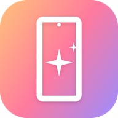

<div align="center">



# Free My Tablet

**A fast, ad-free home screen for your Android tablet.**

The clock, your apps and nothing else. No ads, no banners, no suggestions — and the apps you never use
turned off (never uninstalled). One button brings everything back.

Open source. Built with Claude Code.

</div>

## Why

A tablet from 2019 is slow, and the manufacturer's home screen is half of the reason: it wants you to install
more apps, it shows you what it wants you to see, and it takes a while to open. Free My Tablet replaces it with
one screen that draws fast and shows only what you chose.

## Inspiration

This is the sibling of **[Free My TV](https://freemytv.io)** — the same ideas, the same code style and the same
safety net, but for a tablet instead of a TV: the touch instead of the remote, the notes and the weather
instead of the trending titles, and a home screen that rests (0% of the CPU) instead of animating all day.

The TV project is the reference for the parts that are not about the screen itself: the switch between the
app and the manufacturer's home screen (through the tablet's own ADB), the lists of what to turn off and what
never to touch, the watchdog that gives the home screen back if it crashes three times, and the rule that
nothing is ever uninstalled.

## What you get

- **Only your things.** Not a grid of every app: the clock, the weather (the temperature, the symbol and the
  city) and the apps you picked (Obsidian, YouTube, Termux, your reader, the webapps you installed), and a
  small button for the rest.
- **A quick note.** Write on the home screen without opening anything: the note goes straight into your
  Obsidian vault, as a Markdown file, one per day.
- **A widget.** Pick it in the system's own widget picker: our widget shows the last notes of your vault and a
  tap opens them in Obsidian. Every other widget of the tablet works too.
- **A sync button.** The git pull and the copy over your vault, in one tap: no Termux, no copying folders by
  hand. (Termux does the work — that is where git is.)
- **A space report.** It shows what is using your tablet (the apps, the cache, the notifications) and clears
  the cache of everything with one tap. On a tablet with 2 GB of RAM, that is the difference between slow and
  fast.
- **It updates itself.** The app looks for a new release on its own and tells the person: one tap downloads it
  and opens the installer. No APK to fetch by hand, no repository to watch.
- **Nothing extra.** No ads, no sponsored rows, no promo widgets, no analytics, no account.
- **Light by day, dark by night.** The screen follows the real sunrise and sunset where you are (or you can
  choose the light or the dark one).
- **The bloat turned off.** The apps the manufacturer preinstalled (Microsoft Office, Facebook, the Galaxy Store,
  Bixby, Samsung's diagnostics…) can be switched off in one tap. They are never uninstalled: *Original* brings
  them all back.
- **Safe.** No root. Nothing is uninstalled. One button brings back the factory home screen.
- **Light on an old tablet.** Drawn by hand on one Canvas, no libraries, a 1.9 MB APK, **0.0% of the CPU** at
  rest and 7 MB of memory (the stock launcher: 46 MB, and it never stops drawing).

## Install

About ten minutes. You need an Android tablet (Android 9 or newer) and a computer on the same Wi-Fi.

### The easy way: download the APK

1. Get the APK from the [releases](https://github.com/T3lo5/free-my-tablet/releases) (the file `FreeMyTablet.apk`).
2. Copy it to the tablet and open it (the tablet asks to allow the installation from that app).
3. Open **Free My Tablet** → *Home screen* → *Free My Tablet*, and accept the debugging prompt
   (tick *Always allow*).

There is a short guide in Portuguese: [`docs/instalar.md`](docs/instalar.md).

**And the next updates come from the app itself**: *Free My Tablet → Updates*.

### The easy way: Claude Code

1. **On the tablet**, turn on developer mode: Settings → About tablet → tap *Build number* 7 times. Then Settings →
   *Developer options* → turn on **USB debugging**.
2. **On your computer**:
   ```bash
   git clone https://github.com/T3lo5/free-my-tablet && cd free-my-tablet
   ```
3. **Open [Claude Code](https://claude.com/claude-code)** in that folder and say:
   > Install Free My Tablet on my tablet at 192.168.1.50. I live in Londrina.
4. **On the tablet**, open *Free My Tablet* → *Home screen* → *Free My Tablet*, and accept the debugging prompt
   (tick *Always allow*).

### The manual way

1. **Tools:** a JDK (17+), the Android SDK command-line tools (build-tools 34, platform android-30) and adb. On a Mac:
   ```bash
   brew install --cask temurin android-commandlinetools android-platform-tools
   sdkmanager "build-tools;34.0.0" "platforms;android-30"
   ```
   On Linux, get OpenJDK 17, Android's command-line tools and adb from your package manager. On Windows, use WSL.
   No JDK? Docker works: `docker run --rm -v "$PWD:/work" -v "$HOME/Android/Sdk:/opt/android-sdk" -w /work
   -e ANDROID_HOME=/opt/android-sdk freemytablet-build bash ./build.sh`.
2. **Build:**
   ```bash
   ./build.sh
   ```
   The first run creates `config.properties`: put your city's coordinates there (optional).
3. **Install:**
   ```bash
   adb connect 192.168.1.50:5555
   adb install -r FreeMyTablet.apk
   ```
4. **On the tablet**, open *Free My Tablet* → *Home screen* → *Free My Tablet*. The system asks which home app to
   use: pick Free My Tablet.

## Settings

The settings open from the app's icon (in *All apps*, the button at the bottom right of the home screen) or by
**holding the empty part of the home screen**.

| Where | What |
|---|---|
| *Home screen* | Free My Tablet ⇄ Original (the factory home screen) |
| *Apps on the home screen* | The apps in the row (the ones you use) |
| *Obsidian folder* | Where the quick note is saved (the system's folder picker) |
| *Weather card* | The temperature on the home screen, on or off |
| *Widget* | The widget in the slot (the system's own picker) |
| *Sync* | The git folder in Termux and the command that pulls |
| *Space* | What is using the tablet, and the buttons to free some of it |
| *Who talks to you* | The apps that send the most notifications (a tap opens the system screen) |
| *Updates* | Looks for a new release and installs it (the system asks to confirm) |
| *Apps to turn off* | The preinstalled apps you never use (Bixby, Samsung Internet, the Play apps…) |
| *Language* | Automatic, Português, English, Español |
| *Theme* | Automatic (follows the sun), Light, Dark |

### The sync

The button at the bottom left does what you do by hand today: `git pull` in the working folder, then the copy
over the folder Obsidian reads (the `.git` and the `.obsidian` stay). It needs two things, once:

- the permission to run commands on Termux (the app asks the system, when you press the button the first time);
- in Termux, one line:
  ```bash
  echo "allow-external-apps = true" >> ~/.config/termux/termux.properties
  ```

The working folder and the pull command are in *Settings → Sync* (`~/pos-coders` and `git pull` by default).

## Going back

On the tablet: *Free My Tablet* → *Home screen* → *Original*. The factory home screen and every app come back
exactly as they were. If the new home screen ever crashes three times in five minutes, it switches back by itself.

To remove it for good, switch to *Original* first, then uninstall *Free My Tablet* (Settings → Apps).

## How it works

- **A plain Android app, no Gradle, no libraries.** [`build.sh`](build.sh) runs aapt2 → javac → d8 → zipalign →
  apksigner and makes a 1 MB APK.
- **It asks the system for the home screen.** From Android 10 on, the home app is a role: the system's own dialog,
  no root, no keys. The app's own ADB (127.0.0.1:5555, opened with `adb tcpip 5555`) is only used to turn the
  preinstalled apps off, and the tablet works without it.
- **Drawn by hand on one Canvas**, with no GPU shaders (the tablet stops at Android 11): the sky of the day, the
  icons and the glass, all in one view.
- **The quick note goes to your vault** through the system's own folder picker (SAF): the app has no permission over
  the folder, and you can take it back in the settings.
- **A safety net.** A watchdog in a separate process brings back the stock home screen after three crashes in five
  minutes, and a boot check keeps your choice after an update.
- **Data** from Open-Meteo only: the sunrise and the sunset, where you are. No keys, no account, no tracking.

| File | What it is |
|---|---|
| [`HomeView.java`](app/src/io/freemytablet/HomeView.java) | The home screen |
| [`HomeApps.java`](app/src/io/freemytablet/HomeApps.java) | The apps, their icons and the ones on the home screen |
| [`Vault.java`](app/src/io/freemytablet/Vault.java) | The quick note in your Obsidian folder |
| [`HomeMode.java`](app/src/io/freemytablet/HomeMode.java) | Switching between Free My Tablet and Original |
| [`Adb.java`](app/src/io/freemytablet/Adb.java) | The tablet's own ADB, from inside the tablet |
| [`SettingsActivity.java`](app/src/io/freemytablet/SettingsActivity.java) | The settings screen |
| [`Sky.java`](app/src/io/freemytablet/Sky.java) | The colors of the day |
| [`Sun.java`](app/src/io/freemytablet/Sun.java) | The sunrise and the sunset where you are |
| [`Prefs.java`](app/src/io/freemytablet/Prefs.java) | Settings changed on the tablet |
| [`Watchdog.java`](app/src/io/freemytablet/Watchdog.java) | The safety net |

## Privacy

No accounts, no analytics, no tracking. The app talks to Open-Meteo (with the coordinates you set) and to
nothing else. Your settings stay on your tablet.

## Credits

- Built with [Claude Code](https://claude.com/claude-code).
- Inspired by [Free My TV](https://freemytv.io) — the same family, for TVs.
- Weather data by [Open-Meteo.com](https://open-meteo.com/) (CC BY 4.0).
- Icons: [Material Symbols](https://fonts.google.com/icons) (Apache 2.0). Font: [Inter](https://rsms.me/inter/)
  (SIL OFL 1.1).
- Not affiliated with Samsung, Google or any app. App names and logos belong to their owners.

## Building it

```bash
./build.sh
```

A JDK 17 and the Android SDK (build-tools 34+, platform android-30) are all it takes. No Gradle, no libraries.
Every push is built by GitHub to make sure it compiles, and every tag publishes a release with the APK.

## License

[MIT](LICENSE). Fork it, change it, ship it.

The research behind the choices — the complaints people have about tablets, what the internet says about them,
and how to make one use less — is in [`docs/pesquisa.md`](docs/pesquisa.md) (in Portuguese, with the numbers
measured on a Galaxy Tab A 8.0).
